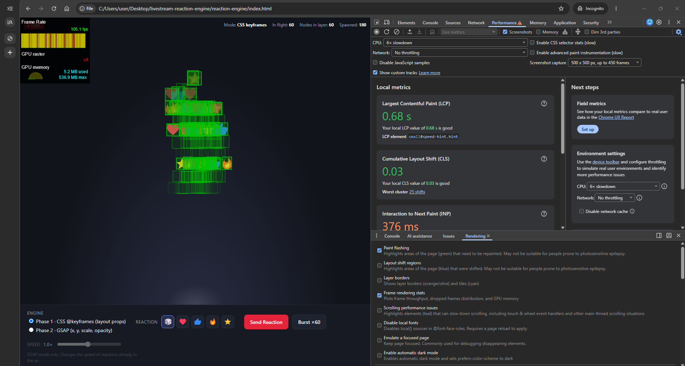
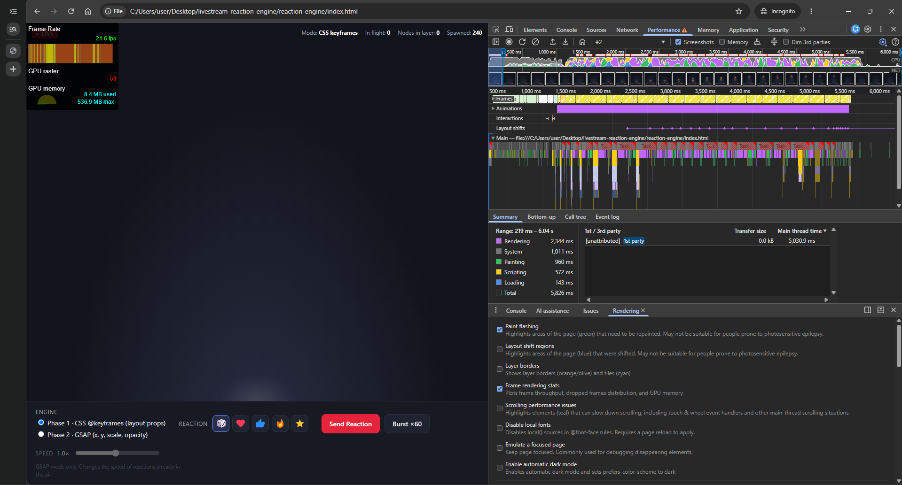
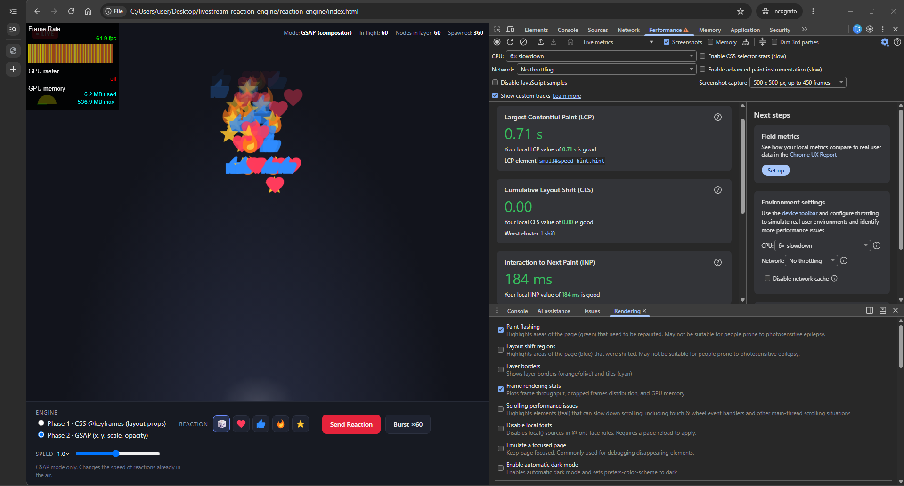
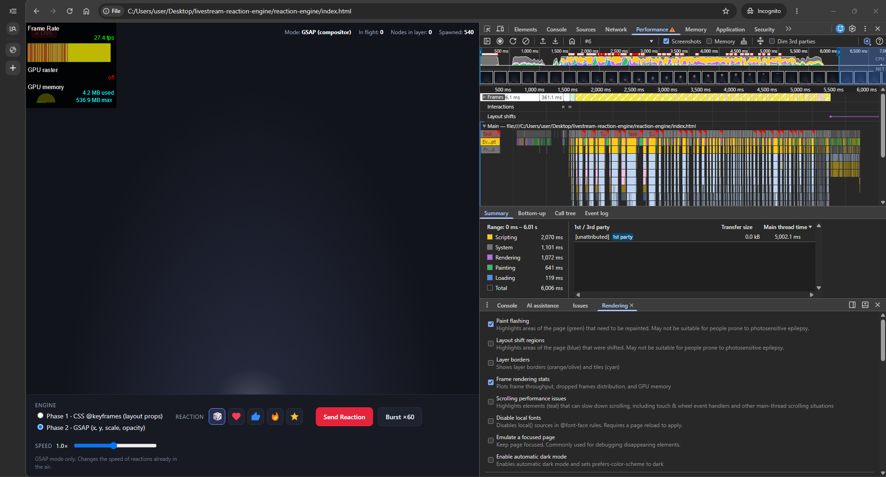
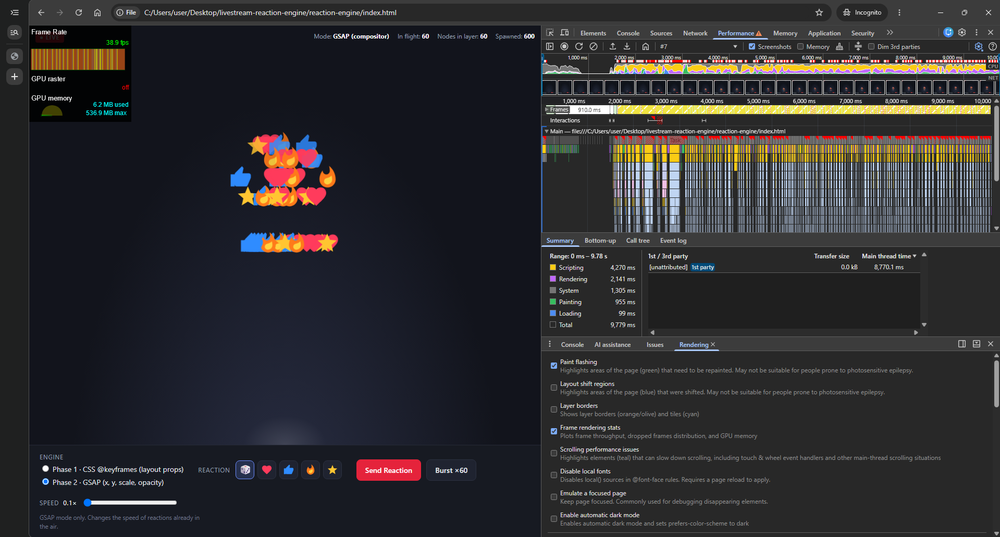
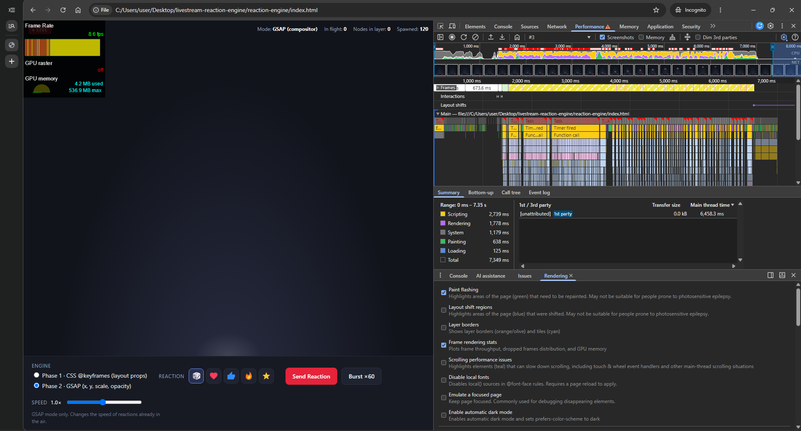
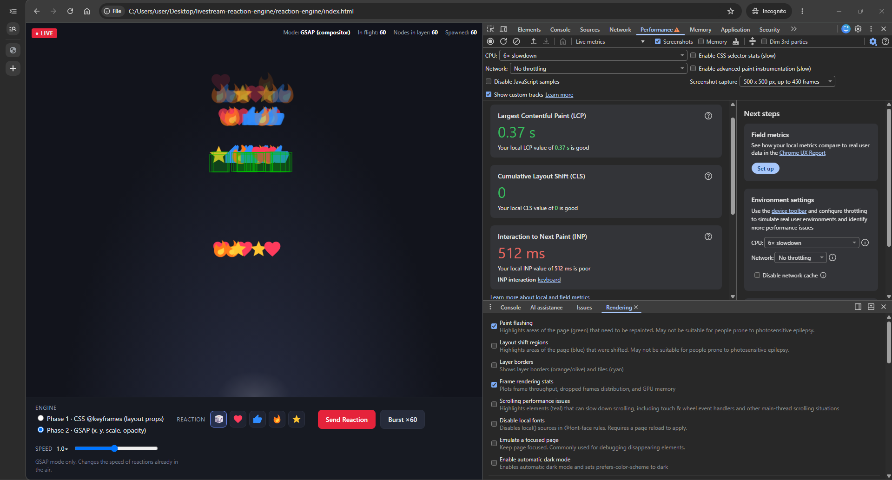

# Livestream Reaction Engine — Submission

A "floating reactions" engine built twice so the two can be compared directly:

|                          | Phase 1                                                                     | Phase 2                                            |
| ------------------------ | --------------------------------------------------------------------------- | -------------------------------------------------- |
| Animation driver         | CSS `@keyframes`                                                            | GSAP timelines                                     |
| Animated properties      | `bottom`, `margin-left`, `width`, `height`, `opacity` (**layout/geometry**) | `x`, `y`, `scale`, `opacity` (**compositor-only**) |
| Mid-flight speed control | ✗                                                                           | ✓ `timeScale()` slider                             |
| Cleanup                  | `animationend` → `el.remove()`                                              | `onComplete` → `tl.kill()` + `el.remove()`         |

Both engines share the same stage, icons, and controls, and you switch between them with the **Engine** radio buttons, so each profile compares only the animation technique.

---

## 1. Setup & Running Instructions

No build step and no install. GSAP 3.15.1 is saved in `vendor/`, so the project also works offline.

```bash
git clone <this-repo>
cd livestream-reaction-engine
# Option A: open index.html directly in Chrome
# Option B: serve it
npx serve .        # or: python3 -m http.server 8000
```

**Controls**

- **Engine:** switch between Phase 1 (CSS) and Phase 2 (GSAP). Switching clears all reactions in flight.
- **Reaction:** choose one icon, or 🎲 for a random one each time.
- **Send Reaction** (or press `Space`): spawns one reaction.
- **Burst ×60** (or press `B`): spawns 60 reactions over about 1 second, a repeatable 50+ concurrent load for profiling. If the main thread is so busy that timer ticks arrive late, each tick spawns the reactions that are due by elapsed time, so the load stays at 60 per second even at 6× throttling.
- **Speed (0.1×–2.0×):** changes `timeScale` of every reaction already in the air (GSAP mode).
- **Stats (top right):** _In flight_ is the engine's own count. _Nodes in layer_ is the actual DOM child count. When the screen is empty, both return to `0`, which shows that no zombie nodes are left behind.

**Project structure**

```
index.html          markup + inline SVG <symbol> sprite (4 vector icons)
styles.css          layout, Phase 1 @keyframes, Phase 2 base styles
src/css-engine.js   Phase 1 engine
src/gsap-engine.js  Phase 2 engine (batched, no forced style/layout on spawn)
src/main.js         UI wiring, burst, stats (one write per frame via rAF)
vendor/gsap.min.js  GSAP 3.15.1
screenshots/        DevTools evidence
```

**Test conditions for all screenshots:** Chrome (Incognito), DevTools Rendering → _Paint flashing_ + _Frame rendering stats_, Performance → **CPU 6× slowdown**, load = **Burst ×60** (60 reactions in flight at the same time).

---

## 2. Phase 1: CSS Keyframes Analysis

- **Paint Flashing Screenshot:**
  
- **Performance Profile Screenshot:**
  

| Phase 1 (5.83 s recording)             | Total                                   | Per second |
| -------------------------------------- | --------------------------------------- | ---------- |
| Rendering (Recalculate Style + Layout) | 2,344 ms                                | 402 ms/s   |
| Painting                               | 960 ms                                  | 165 ms/s   |
| System                                 | 1,011 ms                                | 173 ms/s   |
| Scripting                              | 572 ms                                  | 98 ms/s    |
| INP (Live metrics)                     | **376 ms** (needs improvement)          |            |
| CLS (Live metrics)                     | 0.03, **25 layout shifts** in one burst |            |

- **Observations:**
  - **What regions flashed green, and why?**
    Every reaction flashed green on every frame for its whole flight. At 60 concurrent reactions, the column above the spawn area became a solid block of green. The keyframes animate `bottom`, `margin-left`, `width` and `height`, which are all _geometry_ properties. When any of them changes, the box's size or position changes, so each frame the browser must (1) recalculate style, (2) run **Layout** again for the new box, and (3) **Paint** again both the area the box left and the area it moved into. The `width`/`height` growth also means the SVG must be rasterized again at a new pixel size every frame. The stats counters flash too, because their text changes when reactions spawn or are removed. That's a separate, small paint caused by changing content.
  - **What did the main thread look like in the flame chart?**
    A solid wall of **purple (Recalculate Style / Layout)** and **green (Paint)** with **red-striped long tasks (>50 ms)**. Rendering + Painting took about 3.3 s, compared with only 0.57 s of Scripting: the browser was busy rendering, not running app code. In the **Frames** track, almost every frame is yellow/hatched (partially presented). The main thread missed its deadline, so the screen showed partial or old frames. The FPS meter's yellow/red bars show the same thing. Its fps _number_ counts frames sent to the screen, not frames with fresh main-thread updates. The **Layout shifts** track shows dots across the whole flight, because animating `bottom`/`margin-left` moves elements in the layout. Interactions waited behind this work: **INP was 376 ms**.
  - **The animation work also slowed down the code that spawns new reactions.** In the first version of the burst (one spawn per 16 ms timer tick), only about 30 reactions could be in flight at once under 6× throttling: timer ticks were delayed by the rendering work, while each reaction still died after 3 s. The burst now catches up based on elapsed time, so it reaches 60.

---

## 3. Phase 2: GSAP & Composited Rendering Analysis

- **Paint Flashing Screenshot:**
  
- **Performance Profile Screenshot:**
  
- **Slow motion (0.1×) Screenshot:**
  

| Per second of recording | Phase 1 (CSS)    | Phase 2 (GSAP)                   | Change                              |
| ----------------------- | ---------------- | -------------------------------- | ----------------------------------- |
| Rendering               | 402 ms/s         | **178 ms/s** (1,072 ms / 6.01 s) | **−56%**                            |
| Painting                | 165 ms/s         | **107 ms/s** (641 ms)            | **−35%**                            |
| Scripting               | 98 ms/s          | 344 ms/s (2,070 ms)              | +3.5× (GSAP ticker)                 |
| INP                     | 376 ms           | **184 ms** (good)                | **−51%**                            |
| CLS                     | 0.03 (25 shifts) | **0.00**                         | no layout shifts from the animation |

- **Observations:**
  - **How did the flame chart and frame rate change compared to Phase 1?**
    The purple/green rendering wall is replaced by short **yellow scripting** slices: GSAP's `requestAnimationFrame` ticker updates 60 timelines and writes only `transform` and `opacity`, followed by a light style update and **Composite Layers**. Rendering time per second fell 56%, painting 35%, and INP halved to 184 ms. The trade-off is that **GSAP is a JavaScript engine running on the main thread**, so scripting went up about 3.5×. At 6× throttling, that JS still misses some frame deadlines (the Frames track still has yellow frames), but each missed frame costs script time instead of Layout + Paint for 60 elements. A purely declarative alternative (CSS/Web Animations API on `transform`/`opacity`) could run entirely on the **compositor thread**, freeing the main thread, but you'd lose GSAP's runtime control (§4).
  - **What happened to the green paint-invalidation areas?**
    They mostly disappeared. Each reaction is painted **once**, when it spawns (its SVG is rasterized into a GPU texture). After that it flies with no green at all. The compositor moves, scales and fades a texture that's already rasterized, so nothing is painted again. `force3D: true` keeps each reaction on its own compositor layer. The remaining _Painting_ time in the Summary is that one paint per spawn plus the per-frame layer and compositing work for about 60 layers, not repainting content (Paint Flashing confirms this). **CLS dropped to 0**, because transforms don't move anything in the layout.
  - **Slow motion at 0.1×:** every reaction in flight slowed down immediately and smoothly, with no jump, because `timeScale` changes the playhead's _speed_, not its position. The flame chart has the same shape as at 1× (scripting about 437 ms/s, rendering about 219 ms/s over a 9.78 s recording): the ticker does the same work every frame however fast the timeline plays. Reactions just stay on screen longer. Setting the slider back to 2× makes them finish early and clean up normally.

### Profiling found a bug: layout thrashing on spawn (and the fix)

The first Phase 2 profile had more rendering work than expected for a transform-only animation, with large **"Timer fired → Function call"** blocks containing purple style/layout work.

- **Before fix:** 
  

Stack traces in the trace (`disabled-by-default-devtools.timeline.stack`) pointed to **forced synchronous style recalculation and layout inside GSAP's `_initTween` / `_parseTransform`**:

1. Each spawn did `appendChild` (a **write**), and then GSAP read the new element's computed style (a **read**). That repeated for every reaction in a batch, so each read forced a fresh style recalc.
2. `transformOrigin: '50% 50%'` made GSAP **measure** each element to convert percentages to pixels: a forced layout per reaction (and unnecessary, since it's the CSS default).
3. `gsap.set` / `fromTo` render immediately, so every reaction did a read followed by a write.

**Fix** (`src/gsap-engine.js → spawnMany`):

- Build all nodes for a tick first, set their start state as **inline CSS** (writes only), and insert them with **one `appendChild(fragment)`**.
- Use plain `.to()` tweens, so they start inside GSAP's ticker, where **lazy rendering** does all reads first and puts the writes off to the end of the frame.
- Remove `transformOrigin`, and pre-set `translate/scale/rotate: none` inline so GSAP's own first-parse write changes nothing and doesn't mark style as stale.

| Phase 2                                 | Before fix (7.35 s) | After fix (6.01 s)      |
| --------------------------------------- | ------------------- | ----------------------- |
| Rendering                               | 1,778 ms (242 ms/s) | **1,072 ms (178 ms/s)** |
| Scripting                               | 2,739 ms (373 ms/s) | **2,070 ms (344 ms/s)** |
| INP                                     | 512 ms (poor)       | **184 ms (good)**       |
| Forced style recalcs / forced layouts\* | 121 / 61            | **61 / 12**             |

\*Counted from a Chrome trace of the same 60-reaction burst at 6× throttling. The one forced read left per new element happens inside GSAP's first parse of that element. Removing it would mean reusing pooled nodes (which conflicts with the "remove from DOM" requirement) or using the Web Animations API.

**Lesson:** moving to compositor-only properties fixes the per-frame cost, but _setting up_ the animation can still thrash layout. Profiling, not guessing, showed where the cost was.

### Resolution independence

Icons are inline **SVG `<symbol>`s** (vector), not PNG/emoji bitmaps. Each GSAP reaction is authored at its **maximum** size (48 px) and animates `scale` from 0.6 → 1.0. A compositor layer is rasterized and then scaled as a texture. Scaling _up_ past the raster size would stretch the bitmap and blur it. Scaling _down_ from a full-resolution raster keeps edges sharp throughout the flight.

---

## 4. Architectural Reflection

- **Runtime Control & Developer Experience**

  CSS keyframes are _declarative and fixed_. Once a rule is attached, its timing, path and easing are fixed in the stylesheet. Changing speed in mid-flight means either changing `animation-duration` (which **jumps** the element, because progress is recalculated against the new duration) or reading each element's progress and setting a negative `animation-delay` by hand. Random paths can only use what CSS variables give you, and they're set at spawn time. You can't change a path in mid-flight without restarting the animation. Coordinating rise + sway + fade means keeping separate keyframes in sync, and `animationend` fires once per animation, so cleanup has to filter by `animationName`.

  GSAP timelines are _objects you can control at runtime_. Each reaction is a `Timeline` kept in a `Set`, so speed control is one line (`tl.timeScale(v)`) applied to all of them, with no jump. The same handle supports `pause()`, `reverse()`, `seek()` and `progress()`, and tweens can be changed in mid-flight (for example, a "wind gust" that changes every reaction's sway target). Randomness is plain JS (`gsap.utils.random`) at any time, sequencing uses the position parameter instead of keyframe percentages, and the lifecycle is explicit (`onComplete` → `kill()` → `remove()`). The cost, measured above, is main-thread JavaScript every frame: if the main thread is blocked (heavy JS, GC), GSAP animations stutter, while compositor-only CSS/WAAPI animations would keep running. For a livestream UI where reactions must respond to app state, that control is usually worth it, as long as setup is batched to avoid layout thrashing.

- **Pipeline Considerations (programmatic vectors vs pre-rendered raster sequences)**
  - **Combinations of variants:** sprite sheets or PNG/WebP sequences need one asset set _per variant_. Tints × themes × sizes × DPRs (1×/2×/3×) multiply quickly into many assets to produce, ship and cache. A vector is _one source_ with variant values supplied at runtime (`fill: var(--reaction-tint)`, `currentColor`, CSS variables, GSAP tweening `fill`), so re-theming is a property change, not a new download.
  - **Resolution independence:** vectors are rasterized at the device's real pixel density and size, so they stay sharp on high-DPI phones and when zoomed. Raster frames are only sharp at the size they were exported at.
  - **Payload & memory:** a few hundred bytes of path data versus kilobytes to megabytes of frames. Decoded bitmaps use `width × height × 4 bytes` of GPU/RAM _per frame_, which matters a lot with 50+ instances on low-end mobile.
  - **Runtime responsiveness:** user preferences (dark mode, high contrast, team colors, `prefers-reduced-motion`) can be applied when they change, even to reactions already in flight, and paths can be generated in code. A baked sequence can't respond to state.
  - **Where to change color matters for performance:** changing `fill`/color forces a **paint** (it isn't compositor-only). So the architecture should apply the tint _once at spawn_ (or when the theme changes) and animate only `transform`/`opacity` in flight. That keeps the cheap compositor path and still allows dynamic theming. For per-frame color effects, crossfade `opacity` between pre-tinted layers, or use a CSS `filter` on a promoted layer.
  - **Where raster still wins:** very complex illustrations (thousands of paths, gradients, blur) can cost more to rasterize than to decode a bitmap. Detailed frame-by-frame "hero" animations may fit better as video, sprite sheets, or a canvas/WebGL renderer with texture atlases. The choice should come from measuring: rasterization cost × instance count vs. decode/memory cost × variant count.

---

## Appendix: How the measurements were taken

1. DevTools → `Ctrl/Cmd + Shift + P` → **Show Rendering** → enable **Paint flashing** and **Frame rendering stats**.
2. **Performance** panel → ⚙️ → **CPU: 6× slowdown** (check the dropdown in the capture settings: it can reset after a reload).
3. Reload, choose the engine, record → **Burst ×60** → wait about 4 s → stop → **Summary** tab.
4. INP and CLS were read from the Performance panel's **Live metrics** after a fresh reload for each phase (they add up across the session otherwise).
5. Phase 2 slow motion: record → Burst ×60 → drag Speed to **0.1×** while reactions are rising.

Recordings had slightly different lengths, so the comparison tables also show **ms per second of recording**. Absolute numbers depend on hardware. The ratios between phases are the meaningful part.
